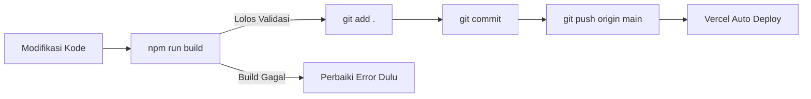

# 🚀 Alur Kerja Pengembangan & Deployment (Contributing Guidelines)

Dokumen ini menjelaskan SOP dan alur kerja otomatis untuk setiap perubahan kode pada proyek **Olimpiakids - Lomba Bayi**.

---

## 📌 Standard Operating Procedure (SOP) Perubahan Kode

Setiap kali melakukan perubahan (fitur baru, perbaikan bug, pembaruan desain, atau tweak kecil), langkah-langkah berikut wajib dijalankan secara berurutan:



### 1. Validasi Build Lokal
Sebelum melakukan commit dan push, pastikan aplikasi terbebas dari kesalahan tipe data (TypeScript), syntax error, atau kompilasi bundler:
```bash
npm run build
```
> ⚠️ **PENTING**: Jika `npm run build` menghasilkan error, **JANGAN** lakukan push ke remote repository sebelum error tersebut diperbaiki hingga tuntas.

### 2. Pementasan Perubahan (Staging)
```bash
git add .
```

### 3. Commit Berstandar (Conventional Commits)
Gunakan format commit pesan yang deskriptif dan konsisten:
- `feat: <penjelasan fitur baru>`
- `fix: <penjelasan perbaikan bug>`
- `docs: <penjelasan pembaruan dokumentasi>`
- `style: <penjelasan perapihan format atau visual>`
- `refactor: <penjelasan restrukturisasi kode tanpa mengubah fungsionalitas>`
- `chore: <penjelasan pemeliharaan dependency atau konfigurasi>`

Contoh:
```bash
git commit -m "feat: redesign ranking table with prototype bevel styling"
```

### 4. Push ke GitHub
Kirim seluruh commit lokal yang sudah divalidasi ke branch `main`:
```bash
git push origin main
```

### 5. Deployment Otomatis (Vercel)
- Repositori GitHub terhubung langsung ke project Vercel `olimpiakids`.
- Setiap push ke branch `main` secara otomatis memicu proses build dan rilis ke lingkungan produksi:
  - **URL Produksi**: [https://olimpiakids.vercel.app](https://olimpiakids.vercel.app)
  - **GitHub Repo**: [https://github.com/kikirachmat2/olimpiakids](https://github.com/kikirachmat2/olimpiakids)

---

## 🔒 Proteksi Kredensial
Jangan pernah menghapus aturan ignore untuk file rahasia di `.gitignore`. File kredensial aktif lokal seperti `.env.local` tidak boleh di-push ke publik. Gunakan `.env.example` untuk dokumentasi variabel environment.
